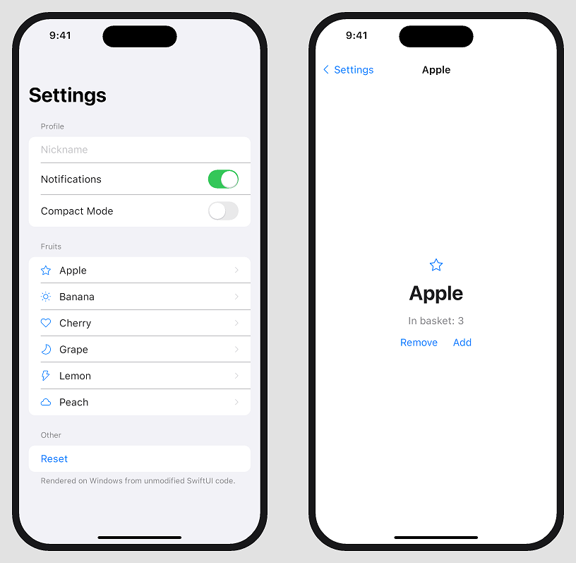

# swiftui-windows-preview

Live **SwiftUI previews on Windows**. Edit the views of an iOS app on a Windows PC and see them update in an iPhone-framed window a few seconds after every save — no Mac, no simulator.

It is an independent, open reimplementation of a subset of the SwiftUI API, written in Swift and rendered with Win32/GDI. Your view code is compiled unmodified (`import SwiftUI`) with the official Swift toolchain for Windows.



*The demo in [`Examples/Demo`](Examples/Demo/ContentView.swift), rendered on Windows (with the optional SF Pro font).*

> Not affiliated with Apple. "SwiftUI", "iPhone" and "SF Pro" are trademarks of Apple Inc. This project contains no Apple code or assets.

## What works

- **Views:** `Text`, `Image(systemName:)` (mapped to Segoe Fluent Icons), `Button`, `Label`, `TextField`, `Toggle`, `Divider`, `Spacer`, `Color`, `Rectangle`, `RoundedRectangle`, `Circle`, `Capsule`
- **Containers:** `VStack`, `HStack`, `ZStack`, `Group`, `ForEach`, `ScrollView`, `List` / `Form` (inset-grouped style), `Section` (header/footer)
- **Navigation:** `NavigationStack`, `NavigationLink`, `.navigationTitle` (large and inline titles, back button)
- **State:** `@State`, `@Binding`, `Binding.constant`
- **Modifiers:** `.padding`, `.frame` (fixed and `maxWidth: .infinity`), `.font`, `.fontWeight`, `.bold`, `.foregroundStyle`, `.foregroundColor`, `.tint`, `.background`, `.cornerRadius`, `.clipShape`, `.multilineTextAlignment`, `.textFieldStyle(.roundedBorder)`, `.imageScale`
- **Layout:** SwiftUI's propose-size / choose-size model, flexible spacers, text wrapping
- **Interaction:** clicks, typing, mouse-wheel and drag scrolling, push/pop navigation
- `#Preview { ... }` blocks (falls back to `ContentView()`)

## Not yet

`Image("asset")`, animations and transitions, `@Observable` / `ObservableObject`, `Picker`, `Sheet`, `TabView`, `GeometryReader`, dark mode, and many more modifiers. Contributions welcome.

## Requirements

- Windows 10/11
- [Swift 6.4 for Windows](https://www.swift.org/install/windows/) (`winget install Swift.Toolchain`)
- Python 3

## Usage

```
git clone https://github.com/argentwow/swiftui-windows-preview
cd swiftui-windows-preview
python preview.py <path-to-your-ios-project>
```

`preview.py` watches the project's `.swift` files, copies them (except the `@main` App file) into the `PreviewHost` target, rewrites `#Preview` blocks into functions, builds, and relaunches the preview window. Build errors are printed in the console and the previous preview stays open.

Try it with the bundled demo: `python preview.py Examples/Demo`

Projects inside WSL work too, e.g. `python preview.py //wsl.localhost/Ubuntu-24.04/root/apps/MyApp`.

The script expects the toolchain at `%LOCALAPPDATA%\Programs\Swift` (the installer default). Adjust `SWIFT_HOME` and the version folders at the top of `preview.py` if yours differs.

### Troubleshooting: `'stdlib.h' file not found`

The Swift toolchain needs the Visual Studio C++ tools and the Windows SDK. If Visual Studio's installer registry is damaged, the compiler can't find them even though they are installed. `preview.py` works around this by pointing `VCToolsInstallDir` at the newest MSVC toolset it finds; for manual builds set it yourself and use the classic build system (`swift build --build-system native`), e.g.

```
set VCToolsInstallDir=C:\Program Files\Microsoft Visual Studio\18\Community\VC\Tools\MSVC\14.50.35717\
```

## Apple system font (optional)

By default text is drawn with Segoe UI. For an accurate iOS look, download **SF Pro** yourself from <https://developer.apple.com/fonts/>, extract the `SF-Pro-Text-*.otf` and `SF-Pro-Display-*.otf` files and put them in a `fonts/` folder next to `preview.py`. They are loaded privately by the preview process (nothing is installed system-wide). The fonts are not included in this repository because their license does not allow redistribution.

## Layout

```
Sources/SwiftUI/      the SwiftUI reimplementation (Views, layout nodes, Win32 runtime)
Sources/PreviewHost/  preview executable; preview.py fills it with your views
Sources/CounterApp/   small standalone demo app
Examples/Demo/        iOS-style demo (List, NavigationStack, TextField, Toggle)
preview.py            live preview watcher
```

Build the demo directly with `swift build --build-system native --product CounterApp`.

## License

MIT
